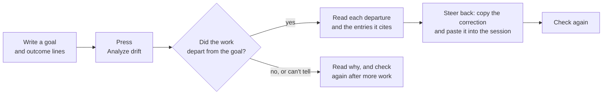
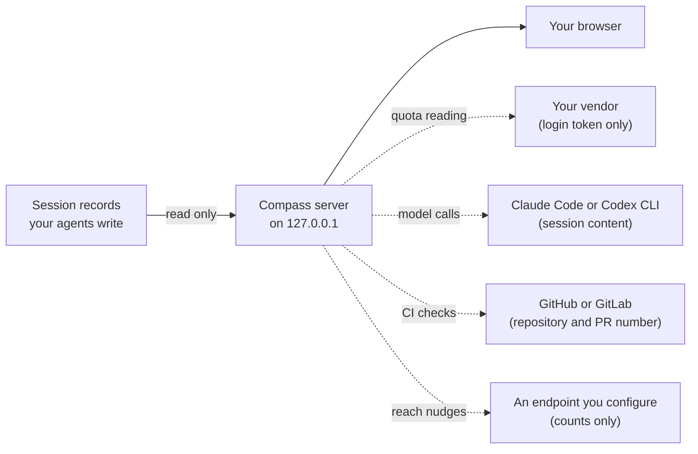

# How Compass works

Compass shows every coding-agent session on your machine in one browser tab. For each session it
tells you what the agent is doing, whether it is waiting on you, and whether its work still matches
the goal you gave it. It works with ten harnesses (the agent tools themselves, such as Claude Code,
Codex and Gemini CLI) by reading the session records they already write.

To try it, install the plugin (see the [README](../README.md#1-how-to-set-up)), then ask your agent to
"open compass" or run `/compass:compass`. The dashboard opens at `http://127.0.0.1:4553/`. To see what
a finished drift check looks like before you run one, open "See a sample session (view only)" above
the Sessions list.

## Checking a session for drift

Drift is when an agent's work moves away from what you asked for: it changes files you did not
want touched, stops short, or says it finished when its own record shows otherwise. Compass checks
for drift by comparing your goal with what the session recorded: its messages, the checks and
commands it ran, and the files it wrote.

The picture above is the Drift card on the sample session. The agent reported the milestone 97.3%
complete, then said it had found a blocker, and the reader then said a ticket was still open.
Compass reads that as a departure from the goal "burn down the milestone", at a Medium level, and
cites the three entries it rests on as `[41]`, `[79]` and `[80]`. Below it, the agent's claim that
the build work was "done and merged" is shown as contradicted by entry `[80]`.

A check goes like this:

1. On the session's page, write the goal you are holding the session to in the Intent card. You can
   add up to six expected outcome lines: what should be true when the work is done.
2. Press Analyze drift. This sends the session's content to a model (see
   [what can leave your machine](#what-can-leave-your-machine)).
3. The Drift card shows a level: None or low, Medium, High or Extreme. When the record cannot support
   a level, it says Not enough recorded yet. Under the level, each departure and each outcome line
   says what the record shows, with citations.
4. For a departure, press Steer back. Compass writes a correction from your own goal and outcome
   lines. You edit it, copy it and paste it into the session yourself; Compass never types into a
   session.
5. After the agent does more work, the button reads Check again. When the reading is current, it
   reads Analyze again.

Read a level as an account of the evidence, not a verdict you can rely on: the reader's accuracy
check has not passed. A citation such as `[41]` lets you see the evidence for yourself. Hover over it
or focus it to read that entry's own words, or choose "See in context of the session" to jump to it in
the session's full activity.

## A session's page

Each session's page has three cards, one under another:

- Intent: your goal and expected outcome lines.
- What the session has done: Compass's own outline of a Claude Code or Codex session, built without a
  model. On Claude Code it adds a model-written summary: an opening paragraph, then phases that start
  closed and open when you press them. A phase holding evidence of drift, or failed test runs, says so
  on its heading.
- Drift: the check described above, and what became of anything it raised.

On a Claude Code session, the Drift card also has a Live monitor switch. With it on, Compass asks
Haiku, through your Claude Code, about once a minute while you view the page where the latest turns
are heading, and shows the answer labeled Live monitor · Haiku. The monitor's own accuracy check has
not been run yet. Until an answer arrives, or while the monitor is paused or has reached its limit,
the card shows an estimate built from the session's checks and file paths. After 20 minutes the
monitor asks whether you still want it, and turns itself off if nobody answers.

## What can leave your machine

The server reads your agents' session records (transcripts, task files and SQLite databases) without
changing them, and serves the dashboard to your browser. Everything the page loads ships with
Compass, so opening it fetches nothing from the internet. The server listens only on `127.0.0.1`.
`--host 0.0.0.0` exposes it on every network interface with no password; read
[SECURITY.md](../SECURITY.md#scope) first, and prefer an SSH tunnel.

Four kinds of traffic can leave your machine. The quota reading is on by default. The other three
start from something you do: pressing a button, opening a finished Claude Code session, turning on the
Live monitor, or setting an endpoint URL.

| Traffic | When | What is sent, and to whom | How to stop it |
|---|---|---|---|
| Quota reading | On by default | Your login token to your vendor, so the page can show quota windows. No session content. The Anthropic login covers any harness signed in to the same Claude subscription; Cursor is read on macOS only. | The switch in the page, or `--no-usage` |
| Model calls | When you press a button that needs one, open a finished Claude Code session, or turn on the Live monitor | Session content, through the Claude Code or Codex CLI already on your machine, signed in as you | Pause model calls, or `--no-observer-model` |
| CI checks | When you press Analyze drift on a session tied to a pull request (or a GitLab merge request your goal names by its URL, on a host `glab` already knows), in a session whose folder is known | The repository and the pull request number, or the branch name, through your own `gh` or `glab`. The checks it reads go on to the reading model. Where GitHub names the required checks, only those count. | The switch beside the notice, `--no-ci-read`, or anything that stops model calls |
| Reach nudges | Only after you set an endpoint URL | Counts only, such as how many sessions are waiting on you, to the endpoint you set | Leave the URL unset, or `--no-reach` |

[SECURITY.md](../SECURITY.md#scope) is the full account of all four, and its
[model-call policy](../SECURITY.md#observer-model-calls) says exactly what each model call sends and
how much.

### What calls a model

Compass has no model of its own. When it needs one, it runs the Claude Code or Codex CLI already on
your machine.

| What happens | Which CLI |
|---|---|
| You press Analyze drift | Claude Code for a Claude Code session (Codex if `claude` is not installed), Codex for a Codex session, and Codex first for other harnesses |
| You open a finished Claude Code session, or press Summarize or Update summary | Claude Code, to write the session summary |
| You press Find goal | A model reads the prompts you typed to find the session's goal |
| You press Summarize this session in a project's Console | Codex, to summarize the focused session and up to three active child sessions |
| You turn on the Live monitor on a Claude Code session | Haiku through your Claude Code, about once a minute while you view it |

Compass shows what each kind of call sends and where the first time it runs, and again if the
destination or the kind of content changes. Session summaries run without asking first; the notice
appears beside them.

To stop model calls, press Pause model calls in the page: it stops all of them, the Live monitor
included, until you press Resume model calls. `--no-observer-model` does the same for a whole run.
Turn off summaries stops session summaries only. Checks that read sessions without a press stay off
unless you start Compass with `--unasked-readings`.

## Finding your way around

The dashboard has four tabs. Sessions opens first.

| Tab | Key | What it shows |
|---|---|---|
| Sessions | `s` | Every session, with active work above recent history. Each active session shows where it is, what it is doing now, what it does next and whether it is blocked. Clicking a goal opens that session at its Intent card. |
| Projects | `p` | Sessions grouped by project. Each project has its own page with a briefing on where the project stands, and Now, Course, Decisions and Console views. |
| Attention | `a` | Everything waiting on a person. |
| Intent log | none | Every session on the board, plus the goals Compass has kept, each labeled with where it came from. |

`Escape` goes back to where you opened a session from: Sessions, Attention, or a project's page. A
session opened from a pasted link goes back to Sessions. The current view lives in the URL, so a
reload or a pasted link comes back to the same place.

The Find sessions bar at the top of Sessions searches titles, goals and prompts; press `/` to jump to
it. Filters narrow the list by when a session started or was last active, and by project, harness,
state, drift and goal, and presets cover Waiting on you, Started today and Drift recorded. The counts
at the top always cover the whole board. If a filter hides a session that is waiting on you, a warning
links to it, or to Attention when there are several. Filters reset when you reload the tab.
[The Find sessions design record](design-sessions-search.md) says exactly how they count.

A project's Console view collects delegated work, requests waiting on you and capacity. It also has an
early terminal bridge and session history view; the
[cockpit design contract](design-next-ui.md#cockpit-reconciliation) records their limits.

## Where to go next

- [What Compass promises](promise-map.md): the five questions Compass answers, and where each answer
  stops.
- [The manual](../MANUAL.md): every command-line option.
- [SECURITY.md](../SECURITY.md): everything that can leave your machine, in full.
- [The skill reference](../compass/skills/compass/SKILL.md): data sources, session states and
  troubleshooting for each harness.
- [The sample session design record](design-sample-session.md): how the view-only sample is built.
