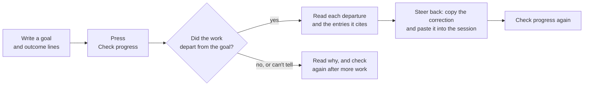
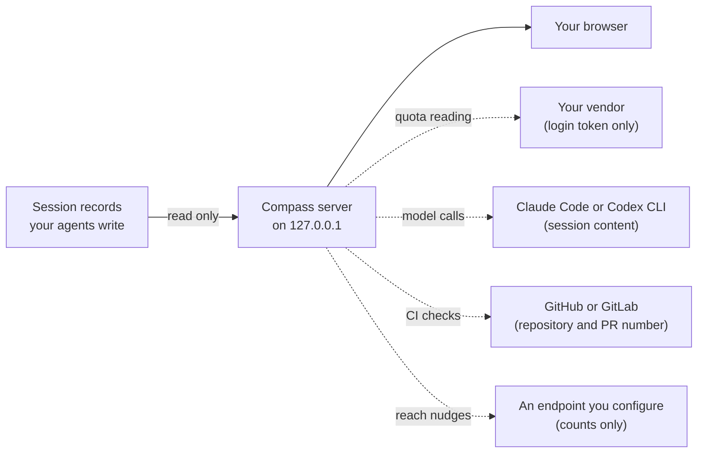

# How Compass works

Compass shows every coding-agent session on your machine in one browser tab. For each session it
tells you what the agent is doing, whether it is waiting on you, and whether its work still matches
the goal you gave it. It works with ten harnesses (the agent tools themselves, such as Claude Code,
Codex and Gemini CLI) by reading the session records they already write.

To try it, install the plugin (see the [README](../README.md#1-how-to-set-up)), then ask your agent to
"open compass" or run `/compass:compass`. The dashboard opens at `http://127.0.0.1:4553/`. To see what
a finished progress check looks like before you run one, open "See a sample session (view only)" above
the Sessions list.

## Checking a session for drift

Drift is when an agent's work moves away from what you asked for: it changes files you did not
want touched, stops short, or says it finished when its own record shows otherwise. Compass checks
for drift by comparing your goal with what the session recorded: its messages, the checks and
commands it ran, and the files it wrote.

In the sample session, the agent reported the milestone 97.3% complete and later found a
blocker. The reader then said an issue was still open. Is it on track? shows Slightly off
course. Follow the quotes link to see the entries behind the finding and the record that
contradicts the agent's claim that the build work was done and merged.

A check goes like this:

1. Open the Goal card to read the saved goal and what done looks like. Press Edit goal to
   change the words, or Use your prompt to start with a message from the session. The prompt
   picker says when it finds no usable prompts or cannot read them. You can save up to six
   lines describing what done looks like.
2. Press Check progress. This sends the session's content to a model (see
   [what can leave your machine](#what-can-leave-your-machine)).
3. Is it on track? shows On track, Slightly off course, Off course or Way off course when
   the record supports a level. On track means Compass found no departure in what it read.
   If Compass found a departure but has no level, the card shows the finding. Codex checks
   always use that approach for departures. The quotes link counts the entries cited by the
   finding and opens Evidence, with focus on the first available quote.
4. When Steer back is available, it opens an editable message based on your goal or a saved
   line describing what done looks like. Use Copy message and paste it into the session
   yourself. Compass never sends it for you.
5. Once a reading is saved, the button reads Check progress again. New work, a changed goal
   or a withdrawn reading can put the check out of date. If a newer check fails to produce a
   reading, the card identifies any finding it shows from the earlier check. Uses AI stays
   beside the check and shows the remaining count when 10 or fewer daily checks are left.

Read a level as an account of the evidence, not a verdict you can rely on: the reader's accuracy
check has not passed. A citation such as `[41]` lets you see the evidence for yourself. Hover over it
or focus it to read that entry's own words, or choose "See in context of the session" to jump to it in
the session's full activity.

## A session's page

Each session's page has three cards, one under another:

- Goal shows your saved goal and what done looks like. How goals work explains what Compass reads.
- What the session has done: Compass's own outline of a Claude Code or Codex session, built without a
  model. It keeps reading on later page updates and says when work remains unread or a limit leaves
  a gap. Check counts may change while earlier checks are reconciled with later recorded work.
  Codex outlines only your messages. On Claude Code it adds a model-written summary: an opening
  paragraph, then phases that start closed and open when you press them. A phase holding evidence of drift, or failed test runs, says so
  on its heading. Long messages can span several parts; a citation still opens the original entry.
  The card distinguishes source it could not collect from parts it collected but did not summarize.
  A finished outline does not fill gaps in a saved summary or confirm that the summary is current.
  Update summary can continue an interrupted message; older summaries made from excerpts offer Summarize again.
- Is it on track? gives the progress answer and its next actions.

At the foot of the page, Show technical details opens the Activity log. Evidence holds the
check's findings, numbered sources, and reading limits. A citation opens Activity log
and takes you to its entry. The log keeps your filter if it includes the entry and switches
to All if needed. Choose You, Agent, Commands, Files or Cited to narrow the loaded record.
Cited includes entries linked from readings and summaries. The log says how many loaded entries
the filter hides. Entries marked "Before reading window" fall outside the progress check for
your current goal.

On a Claude Code session, open **Show technical details** and select **AI use and privacy** to find the **Live monitor** switch.
It says "Checks progress about once a minute while you watch". With it on, Compass asks
Haiku, through your Claude Code, about once a minute while you view the page where the latest turns
are heading. Its source is labeled Live monitor · Haiku in AI use and privacy. The monitor's own accuracy check has
not been run yet. Until an answer arrives, or while the monitor is paused or has reached its limit,
the card shows an estimate built from the session's checks and file paths. After 20 minutes the
browser asks whether you still want it, and drops that browser holder if nobody answers.
You can also start a terminal holder with `--monitor` or the skill's `monitor on` action. It keeps
checking new work without a tab or a browser question until stopped, its session ends or its
connection is lost. [The manual](../MANUAL.md#starting-and-inspecting-an-instance) owns the commands
and limits. A terminal start can save the page's drafted goal when no goal or outcome lines are
saved; it prints those words and their source before checking.

## What can leave your machine

The server reads your agents' session records (transcripts, task files and SQLite databases) without
changing them, and serves the dashboard to your browser. Everything the page loads ships with
Compass, so opening it fetches nothing from the internet. The server listens only on `127.0.0.1`.
`--host 0.0.0.0` exposes it on every network interface with no password; read
[SECURITY.md](../SECURITY.md#scope) first, and prefer an SSH tunnel.

Five kinds of traffic can leave your machine. The quota reading and daily release lookup are on
by default. Three others start from something you do: pressing a button, opening a finished Claude
Code session, turning on the Live monitor, or setting an endpoint URL.

| Traffic | When | What is sent, and to whom | How to stop it |
|---|---|---|---|
| Quota reading | On by default | Your login token to your vendor, so the page can show quota windows. No session content. The Anthropic login covers any harness signed in to the same Claude subscription; Cursor is read on macOS only. | The switch in the page, or `--no-usage` |
| Model calls | When you press a button that needs one, open a finished Claude Code session, or turn on the Live monitor | Session content, through the Claude Code or Codex CLI already on your machine, signed in as you | Pause all AI use, or `--no-observer-model` |
| CI checks | When you press Check progress on a session tied to a pull request (or a GitLab merge request your goal names by its URL, on a host `glab` already knows), in a session whose folder is known | The repository and the pull request number, or the branch name, through your own `gh` or `glab`. The checks it reads go on to the reading model. Where GitHub names the required checks, only those count. | The switch beside the notice, `--no-ci-read`, or anything that stops model calls |
| Release lookup | On by default; after server start and at most once per UTC day per Compass home | Only a `compass/<version> (<os>; <arch>[; ci][; internal])` User-Agent beyond urllib's standard headers to spacedock.md, with no query string. The route counts the lookup itself from its headers. The site counts checks in PostHog without an IP and in Plausible with the caller's IP and user agent; CI-marked checks are not counted. Plausible stores neither and derives approximate location from the address. No identifier or session content. | Turn off daily update checks in Settings, or `--no-update-check` |
| Reach nudges | Only after you set an endpoint URL | Counts only, such as how many sessions are waiting on you, to the endpoint you set | Leave the URL unset, or `--no-reach` |

[SECURITY.md](../SECURITY.md#scope) is the full account of all five, and its
[model-call policy](../SECURITY.md#observer-model-calls) says exactly what each model call sends and
how much.

One more path starts from you and is not traffic Compass sends. When you invoke the `compass` skill
with `sessions` or `sessions waiting`, the agent runs that read-only operation and the list it prints
becomes part of that session's context, so it goes to that session's model provider. `drift` and
`drift again` do the same with that session's own progress reading. Like Check progress, they can
spend one reading. The correction stays out of the session. The list covers
every session on the board, in any harness or project, and
[what can reach into a session](../SECURITY.md#what-can-reach-into-a-session) names each field and what
does and does not stop it. The same command run in a terminal outside the session prints to that
terminal only. There `--drift` needs `--session claude:SESSION_ID` (or `codex:THREAD_ID`) and refuses without it, and a
reading it asks for is stored on the session's page alongside readings from Check progress.

### What calls a model

Compass has no model of its own. When it needs one, it runs the Claude Code or Codex CLI already on
your machine.

| What happens | Which CLI |
|---|---|
| You press Check progress | Claude Code for a Claude Code session (Codex if `claude` is not installed), Codex for a Codex session, and Codex first for other harnesses |
| You open a finished Claude Code session, press Summarize or Update summary, or request a summary from the terminal | Claude Code, to write the session summary; a stored terminal read spends nothing |
| You press Find goal | A model reads the prompts you typed to find the session's goal |
| You press Summarize this session in a project's Console | Codex, to summarize the focused session and up to three active child sessions |
| You turn on the Live monitor on a Claude Code session | Haiku through your Claude Code, about once a minute while you view it or a terminal holder keeps it on |

Compass shows what each kind of call sends and where the first time it runs, and again if the
destination or the kind of content changes. Session summaries run without asking first; the notice
appears beside them.

To stop model calls, press Pause all AI use in the page, run `--pause-model-calls` from a shell or
invoke the skill's `pause` action: it stops all of them, the Live monitor
included, until you press Resume AI use on the page. `--no-observer-model` does the same for a whole run.
Turn off summaries stops session summaries only. Checks that read sessions without a press stay off
unless you start Compass with `--unasked-readings`.

## Finding your way around

Sessions opens first. The header shows how many sessions are Working across the board,
even on a project page.

| Tab | Key | What it shows |
|---|---|---|
| Sessions | `s` | Every session, with active work above recent history. Each active session shows where it is, what it is doing now, what it does next and whether it is blocked. Clicking a goal opens that session at its Goal card. |
| Projects | `p` | Sessions grouped by project. Each project has its own page with a briefing on where the project stands, and Now, Course, Decisions and Console views. |
| Needs you | `n` | Requests, reported blocks and risks. The badge counts Waiting on you and Worth a look. |
| Goal history | none | Every session on the board, plus the goals Compass has kept, each labeled with where it came from. |
| Settings | none | Dashboard preferences and AI use controls. |

`Escape` goes back to where you opened a session from. A session opened from a pasted link goes
back to Sessions. The current view lives in the URL, so a reload or a pasted link comes back to
the same place.

At a glance on Sessions shows what is waiting on you, what is working and what is worth a look.
Waiting on you and Worth a look open Needs you. Working now selects Working and moves focus to
the list. The status tabs and At a glance count the whole loaded board while you filter it.
Search reads titles, goals, prompts and project names. Press `/` to jump to the field.
Open Filters for Project, Agent, Started and Progress check. The level chips are disabled.
No goal yet finds sessions with a published absence of a saved goal, including drafts you
haven't saved. Filters explains when some sessions have unpublished goal data.
More filters for power users holds the complete list of choices, including
Last active, Group, Headless and Goal source.
Headless offers Headless and Interactive or unknown. Claude Code and Codex publish headless status;
Codex uses the rollout entrypoint, with `exec` headless and `cli` interactive. Unknown entrypoints and
other harnesses stay under Interactive or unknown. Both options start unselected, so
every session is shown by default. A quiet headless Codex run with a recorded turn stop says
"run finished" and its age on the list and session page. This is a reversible reading of that turn,
and later work withdraws it. When filters hide a waiting session, the result can link to it or
to Needs you. With no search matches, Show everything clears the choices. Show older sessions
reloads without filters and reads the wider collection. How filter counts work sits inside
More filters for power users. The earlier group names the published window, and How session
history works explains what those rows can tell you. If every discovered source fails, search
results and session counts are unavailable.
The [Find sessions design record](design-sessions-search.md) owns the counting rules.

At the foot of Sessions, Your AI allowance shows the selected quota window, its published reset
and the amount used. The bar marks how far the window has elapsed when the clock is available.
Open How the AI allowance works for the pace, local reset date and time, and source. Turning off
quota reading stops credential-backed fetches in this browser. Fresh Codex disk readings and
Antigravity receipts can still appear. The [quota policy](../SECURITY.md#usage-quota-reads-the-quota-fetcher)
describes what Compass reads and how to stop it.

A launcher can [declare a parent and assign a group](../HOW_TO_USE.md#nest-a-launched-run-under-its-coordinator).
Linked children follow their visible parent on Sessions and name it with a page link. A waiting
parent gets a second line, `Waiting on child "title"`. Sessions and the session page link it to the
child even when a filter hides the child. An open question takes precedence over the child wait.
A reported session end takes precedence in the state label. If the board still publishes a
question for that session, you can answer it on the session page. Sessions shows a status tile
beside the title when the harness publishes enough evidence. The legend names each tile,
including Quiet for an observed turn stop and Ended for a reported session end. If scanning
cannot see a turn end, the row explains that in words. The progress slot on the row is
blank. Open the session page to see the progress reading and any live estimate the session
supports.

A Worth a look flag explains a reported risk or an end with uncommitted work. Use the Worth
a look tab to find those rows. Its count includes only sessions with the flag.

An unmatched declaration says the parent is not on the board and is not linked. Open
a parent to see its linked children and their states, or a child to open its parent. Group labels
stay separate from goals. Inherited labels say "from parent". Inside More filters for power users,
Group by group arranges the rows by label in Right now and the earlier group. Named choices, chips and headings
quote labels; unquoted "No group" means no label.
Filters and grouping last across board refreshes and trips into a session; reloading clears them.

The Projects list and each project's summary count Working, Waiting on you, Ended and Quiet from
the state shown on each member's row. A parent waiting on its child or an idle session without an
observed turn end contributes to `in no counted state`. Needs you also requires an observed turn
end to count a session as Quiet. Needs you and Sessions spell out elapsed times from the
displayed board update, so a wait ages when the next board arrives.

A quiet Codex rollout can still be working while a shell-capable call has no matching output.
Within an open turn, an unanswered `exec`, `exec_command`, `shell_command` or `write_stdin` reads
`running <tool>` for up to 15 minutes from that call. Each parallel call retires on its own output.
A new turn, a user message, a recorded finish or an interruption clears the pending evidence.
The detail names the tool, not a shell command inferred from the JavaScript an `exec` call runs.
The bounded rollout tail must still contain the call. A process killed mid-call without a recorded
end can read Working until the cap; a process still running after the cap falls back to the usual
activity rules. This is a reading of recorded calls, not a process-liveness check.

A quiet transcript can still be working. For Claude Code, an unanswered tool call in the current
step reads `running <tool>` for up to 15 minutes from that call. Only calls in the newest assistant
message qualify; a later assistant message, a human prompt, compaction, a validated Stop or an
interruption ends that foreground wait. Parallel calls in one assistant message may remain pending
independently.
Injected task notifications, system reminders and hook feedback do not end it.
In headless sessions only, background Agent or Task subagents acknowledged by a tool result in the
current turn with no recorded completion read `waiting on 1 background task` or
`waiting on N background tasks`.
Only these background subagents
can keep Working after the parent's Stop, for up to 15 minutes from the newest qualifying outstanding
launch; a later interruption or new user prompt retires that wait. Background Bash and shell jobs
do not qualify. Interactive sessions and sessions whose entrypoint is unknown keep the usual
activity and Stop rules for background subagents. The two caps are independent. An observed
session end ends both waits, and an input request still takes precedence. After either cap, Compass
falls back to its usual activity and stop rules. This covers long foreground calls and headless
sessions waiting on a background subagent, measured with Claude Code 2.1.322 on macOS. A session
killed mid-tool without an observed end can read Working until the 900-second cap, instead of the
usual 90-second activity window. This is an accepted limit: SIGKILL sent no SessionEnd in
[the ending capture](captures/claude/session-end-2.1.261-macos.jsonl), while every other measured
ending did. The [state reference](../compass/skills/compass/reference/dashboard.md#session-states)
explains the other harnesses.

A project's Console view collects delegated work, requests waiting on you and capacity. It also has an
early terminal bridge and session history view; the
[cockpit design contract](design-next-ui.md#cockpit-reconciliation) records their limits.

## Where to go next

- [What Compass promises](promise-map.md): the five questions Compass answers, and where each answer
  stops.
- [The manual](../MANUAL.md): every command-line option.
- [SECURITY.md](../SECURITY.md): everything that can leave your machine, in full.
- [The skill reference](../compass/skills/compass/SKILL.md): data sources, session states and
  troubleshooting for each harness.
- [The sample session design record](design-sample-session.md): how the view-only sample is built.
